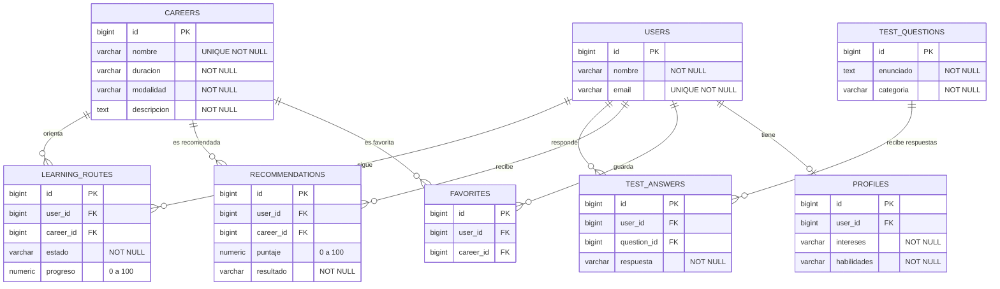

# CareerPath AI — Modelo relacional

Este documento describe el modelo relacional implementado para el backend de CareerPath AI utilizando Supabase PostgreSQL.

El esquema actual está compuesto por ocho tablas relacionadas entre sí para gestionar usuarios, perfiles, carreras, favoritos, recomendaciones, cuestionarios vocacionales, respuestas y rutas de aprendizaje.

## Diagrama entidad-relación

## Relaciones y restricciones

| Tabla | Clave foránea | Referencia | Restricción destacada |
|---|---|---|---|
| profiles | user_id | users(id) | UNIQUE(user_id) |
| favorites | user_id | users(id) | UNIQUE(user_id, career_id) |
| favorites | career_id | careers(id) | UNIQUE(user_id, career_id) |
| recommendations | user_id | users(id) | UNIQUE(user_id, career_id) |
| recommendations | career_id | careers(id) | puntaje entre 0 y 100 |
| test_answers | user_id | users(id) | UNIQUE(user_id, question_id) |
| test_answers | question_id | test_questions(id) | UNIQUE(user_id, question_id) |
| learning_routes | user_id | users(id) | UNIQUE(user_id, career_id) |
| learning_routes | career_id | careers(id) | progreso entre 0 y 100 |

Las relaciones utilizan claves foráneas para mantener la integridad referencial del modelo. Los registros dependientes configurados con `ON DELETE CASCADE` se eliminan automáticamente cuando se elimina su registro principal correspondiente.

Los identificadores utilizan el tipo `BIGINT` y las tablas se encuentran dentro del esquema `public` de Supabase PostgreSQL.

## Datos de prueba y validación

Se cargaron y verificaron cinco registros en cada una de las ocho tablas principales, alcanzando un total de 40 registros de prueba.

Las verificaciones realizadas incluyen:

- existencia de los registros cargados;
- integridad de las claves foráneas;
- ausencia de relaciones huérfanas;
- control de registros duplicados;
- validación de valores de progreso entre 0 y 100;
- validación de puntajes dentro del rango establecido.

La tabla `users` utiliza registros ficticios destinados exclusivamente a pruebas del esquema.

## Seguridad

Las tablas utilizan Row Level Security (RLS) dentro de Supabase.

En esta etapa no se definen políticas públicas de acceso desde los scripts SQL. Las políticas definitivas deberán implementarse junto con el sistema de autenticación y autorización del backend.

## Persistencia

El modelo relacional se encuentra creado y validado en Supabase PostgreSQL.

Los recursos REST generados mediante NestJS mantienen actualmente servicios provisionales y todavía no realizan operaciones de persistencia directa sobre Supabase.

La integración entre los servicios NestJS y la base de datos forma parte de una etapa posterior del desarrollo.

## Orden de ejecución de los scripts SQL

Para reproducir el esquema de base de datos se recomienda ejecutar los scripts en el siguiente orden:

1. `sql/00-crear-users-demo.sql`
2. `sql/04-crear-tablas-careers-recommendations.sql`
3. `sql/01-crear-tablas-profiles-favorites.sql`
4. `sql/07-crear-tablas-test-rutas.sql`
5. `sql/05-insertar-carreras-recomendaciones.sql`
6. `sql/02-insertar-registros.sql`
7. `sql/08-insertar-test-rutas.sql`
8. `sql/06-verificar-carreras-recomendaciones.sql`
9. `sql/03-verificar-datos.sql`
10. `sql/09-verificar-test-rutas.sql`

Los scripts están preparados para PostgreSQL y Supabase.

Antes de utilizar una estructura definitiva de `users`, debe verificarse que su clave primaria mantenga compatibilidad con las claves foráneas utilizadas por las demás tablas.