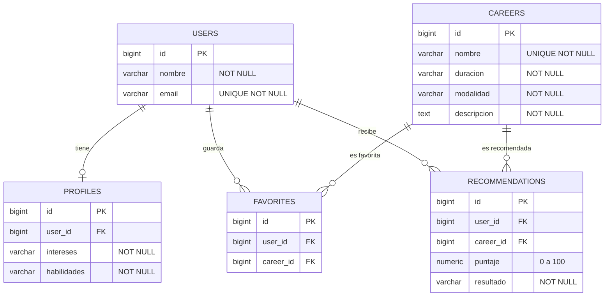

# CareerPath AI — Modelo relacional TP9 (tres integrantes)

Este documento representa **solamente las cinco tablas implementadas y verificadas** de Valentina, integrante 2 y Morena Marina. No modifica ni desarrolla tablas, módulos ni solicitudes del integrante 4.

## Diagrama entidad-relación (Mermaid)

## Relaciones y restricciones

| Tabla | Clave foránea | Referencia | Restricción destacada |
|---|---|---|---|
| profiles | user_id | users(id) | UNIQUE(user_id): un perfil por usuario |
| favorites | user_id | users(id) | UNIQUE(user_id, career_id) |
| favorites | career_id | careers(id) | UNIQUE(user_id, career_id) |
| recommendations | user_id | users(id) | UNIQUE(user_id, career_id) |
| recommendations | career_id | careers(id) | puntaje entre 0 y 100 |

En las cinco relaciones se usa eliminación en cascada para los registros dependientes. Los identificadores del esquema de prueba son `BIGINT` y los registros se crearon en el esquema `public` de Supabase PostgreSQL.

## Alcance y limitaciones

- Se verificaron **cinco registros por tabla**: 25 registros en total.
- Los cinco vínculos de clave foránea figuran en `information_schema`.
- `public.users` usa **usuarios ficticios de prueba**; no implementa registro ni autenticación real.
- Se habilitó RLS en estas tablas y **no se crean políticas públicas** en los scripts de esta etapa.
- **No se representa ni desarrolla** la parte del integrante 4 por indicación del equipo; corresponde incorporarla al modelo conjunto cuando esa persona termine su trabajo.
- Los servicios generados mediante Nest CLI siguen devolviendo respuestas de ejemplo y **aún no consultan Supabase**.

## Orden de los scripts SQL para reproducir el esquema

1. `sql/00-crear-users-demo.sql` (solo pruebas locales; se sustituye por el `users` definitivo de Valentina).
2. `sql/04-crear-tablas-careers-recommendations.sql`.
3. `sql/01-crear-tablas-profiles-favorites.sql`.
4. `sql/05-insertar-carreras-recomendaciones.sql`.
5. `sql/02-insertar-registros.sql`.
6. `sql/06-verificar-carreras-recomendaciones.sql`.
7. `sql/03-verificar-datos.sql`.

Los scripts 01–06 deben ser los de **PostgreSQL/Supabase**, no las versiones previas de MySQL. Si se usa la tabla definitiva de `users`, confirmar previamente que la clave primaria tenga el tipo esperado por las claves foráneas.
